# AWS VPC Peering Microservices

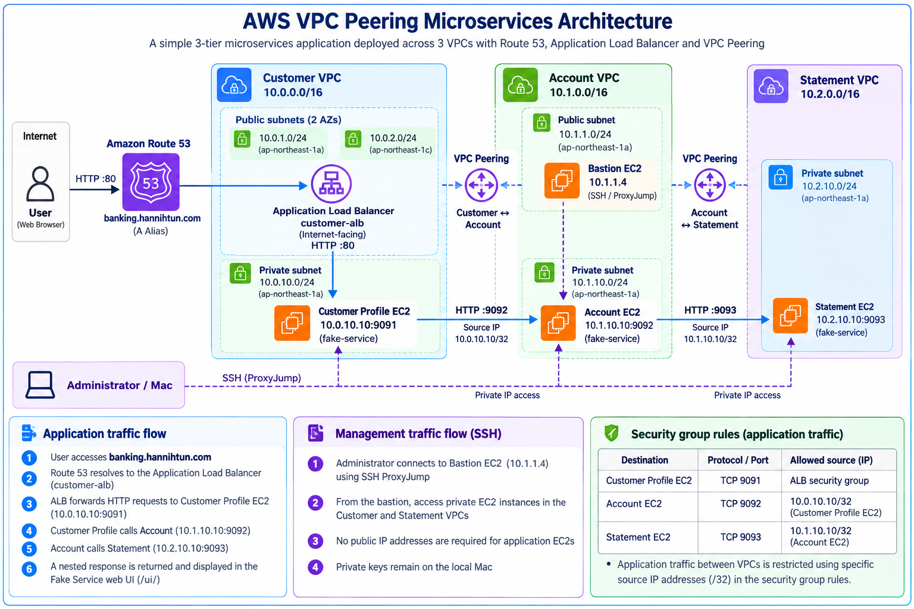

This project demonstrates private microservice communication across three AWS VPCs using VPC Peering, an Application Load Balancer, Amazon Route 53, and a bastion host for secure SSH access.

Three EC2 instances run the open-source `fake-service` application as non-root `systemd` services. Requests flow from Customer Profile to Account and then Statement, with the complete request flow visualized through the Fake Service web interface.

> **Note:** This is a demonstration environment using simulated banking services. It does not process real financial data. The public endpoint uses HTTP rather than HTTPS.

## Highlights

- Built three isolated VPCs in **AWS Asia Pacific (Tokyo), `ap-northeast-1`**, with deliberately nonoverlapping IPv4 ranges.
- Established two VPC peering connections: **Customer ↔ Account** and **Account ↔ Statement**; verified routes in both directions.
- Kept all three application EC2 instances in **private subnets without public IPv4 addresses**.
- Administered instances through an Account VPC **public bastion** using SSH `ProxyJump`; private keys remained on the local Mac.
- Installed the **Linux AMD64**, statically linked `nicholasjackson/fake-service:v0.26.2` executable and verified transfer integrity using SHA-256.
- Created dedicated `fake-service` system users and managed the applications with `systemd`, including restart-on-failure and startup on boot.
- Limited application ingress to the required ports and intended source instances / ALB security group.
- Configured an internet-facing ALB across **two public subnets / Availability Zones**, with a healthy Customer Profile target on TCP 9091.
- Configured an Amazon Route 53 **A Alias** record (`banking.hannihtun.com`) to route traffic to the Application Load Balancer.
- Verified **public HTTP 200** and nested success codes for all three services, including from the built-in `/ui/` graphical view.

## Architecture and Traffic Flow

| Component | Location | Function |
|---|---|---|
| Public DNS | Route 53 public hosted zone `hannihtun.com` | `banking.hannihtun.com` A Alias → Customer ALB |
| Application Load Balancer | Customer VPC, two public subnets | Internet-facing HTTP listener :80 |
| Target group `customer-profile-tg` | Customer VPC | Instance target, HTTP :9091, `/health` |
| Customer Profile EC2 | Customer private subnet | `10.0.10.10:9091` → Account |
| Account EC2 | Account private subnet | `10.1.10.10:9092` → Statement |
| Statement EC2 | Statement private subnet | `10.2.10.10:9093` → no upstream |
| Bastion EC2 | Account public subnet | SSH / ProxyJump, private IP `10.1.1.4` |

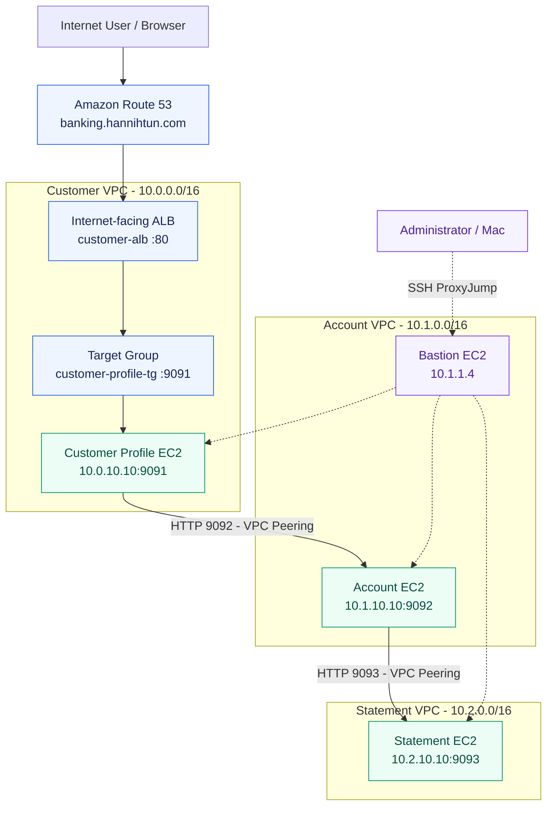

**Important routing concept:** VPC peering is **not transitive**. The Customer–Account and Account–Statement peering connections are independent. Statement traffic is initiated **by Account**, not forwarded transparently from Customer through Account's VPC as a transit router. A peering connection also cannot use another VPC's internet gateway as a shared internet gateway.

> **Implementation note:** Application traffic between VPCs is restricted using specific source IP addresses (`/32`) in the security group rules. The public Application Load Balancer uses HTTP on port `80` for this demonstration.

## Network inventory

| VPC | VPC CIDR | Subnet | Subnet CIDR | Purpose |
|---|---|---|---|---|
| Customer | `10.0.0.0/16` | Public 1a | `10.0.1.0/24` | ALB AZ 1 |
| Customer | `10.0.0.0/16` | Public 1c | `10.0.2.0/24` | ALB AZ 2 |
| Customer | `10.0.0.0/16` | Private 1a | `10.0.10.0/24` | Customer Profile EC2 |
| Account | `10.1.0.0/16` | Public 1a | `10.1.1.0/24` | Bastion |
| Account | `10.1.0.0/16` | Private 1a | `10.1.10.0/24` | Account EC2 |
| Statement | `10.2.0.0/16` | Private 1a | `10.2.10.0/24` | Statement EC2 |

### VPC peering and route-table design

| Peering connection | Participants | State during validation |
|---|---|---|
| `customer-account-pcx` | Customer ↔ Account | Active |
| `account-statement-pcx` | Account ↔ Statement | Active |

| Route table | Destination | Target |
|---|---|---|
| Customer private | `10.1.0.0/16` | Customer–Account peering |
| Account private | `10.0.0.0/16` | Customer–Account peering |
| Account private | `10.2.0.0/16` | Account–Statement peering |
| Account public | `10.0.0.0/16` | Customer–Account peering (bastion SSH to Customer) |
| Account public | `10.2.0.0/16` | Account–Statement peering (bastion SSH to Statement) |
| Statement private | `10.1.0.0/16` | Account–Statement peering |

### EC2 and application inventory

| Instance | Private IPv4 | Port | App name | Operating model |
|---|---|---:|---|---|
| `customer-profile-ec2` | `10.0.10.10` | 9091 | `Customer-Profile` | Amazon Linux 2023; non-root `systemd` |
| `account-ec2` | `10.1.10.10` | 9092 | `account` | Amazon Linux 2023; non-root `systemd` |
| `statement-ec2` | `10.2.10.10` | 9093 | `statement` | Amazon Linux 2023; non-root `systemd` |
| `account-bastion-ec2` | `10.1.1.4` | 22 | SSH jump host | Public subnet |

### Security groups (implemented rules)

| Security group | Inbound port | Allowed source | Purpose |
|---|---:|---|---|
| `customer-alb-sg` | TCP 80 | `0.0.0.0/0` | Public HTTP to ALB |
| `customer-app-sg` | TCP 9091 | `customer-alb-sg` | ALB → Customer Profile |
| `account-app-sg` | TCP 9092 | `10.0.10.10/32` | Customer → Account |
| `statement-app-sg` | TCP 9093 | `10.1.10.10/32` | Account → Statement |
| All three app SGs | TCP 22 | `10.1.1.4/32` | Bastion → private EC2 |
| `bastion-sg` | TCP 22 | Lab operator's public IP `/32` | Restricted SSH entry |

**Security note:** Outbound security group rules were left at their default settings for this lab. In a production environment, outbound access should be restricted based on application requirements.

## Deployment Results

### 1. Network Configuration

The following screenshots show the VPC peering connections, route tables, and security group configurations.

| VPC Peering | Route Tables |
|---|---|
| 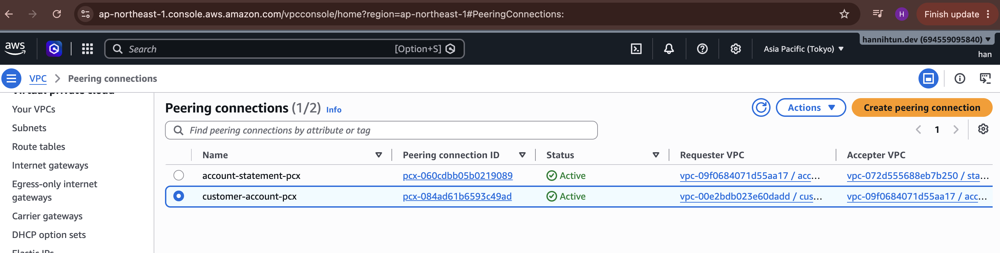 | 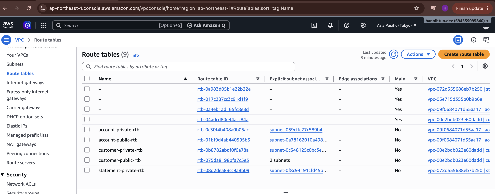 |

**Security Groups**

| Customer Application | Account Application | Statement Application |
|---|---|---|
| 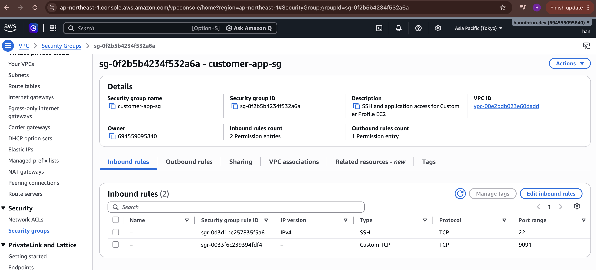 | 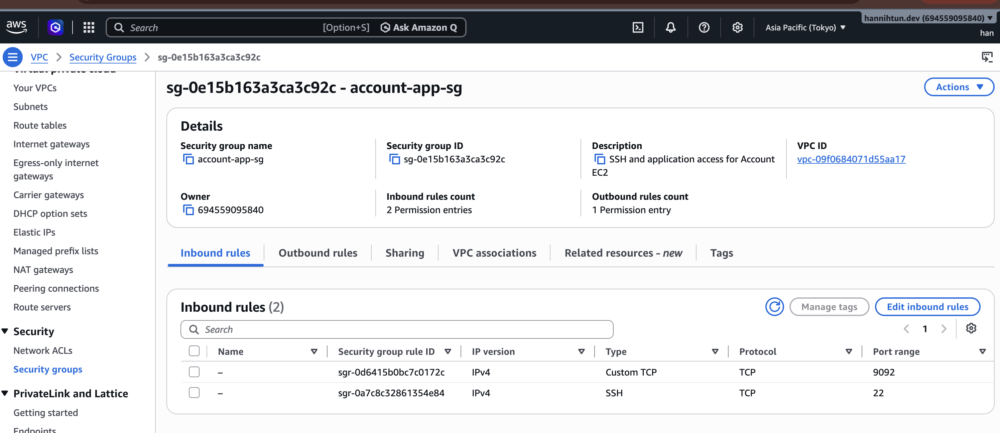 | 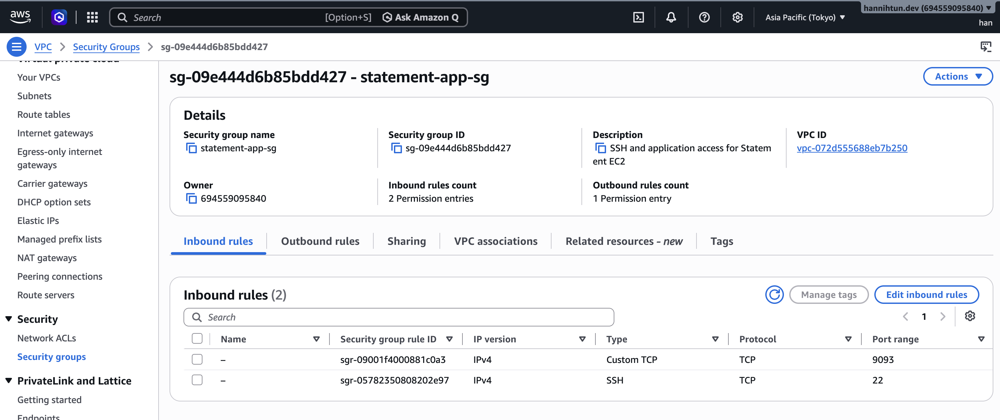 |

### 2. AWS Infrastructure

**EC2 Instances**

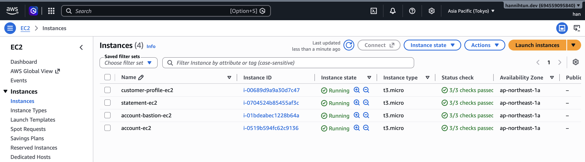

**Application Load Balancer and Target Group**

| Application Load Balancer | Target Group |
|---|---|
| 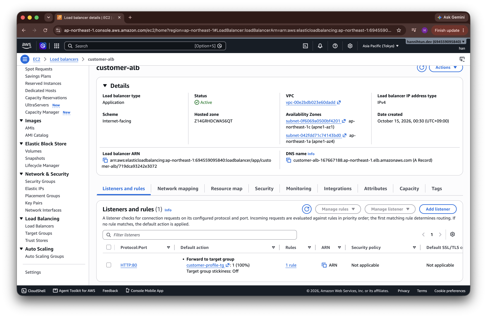 | 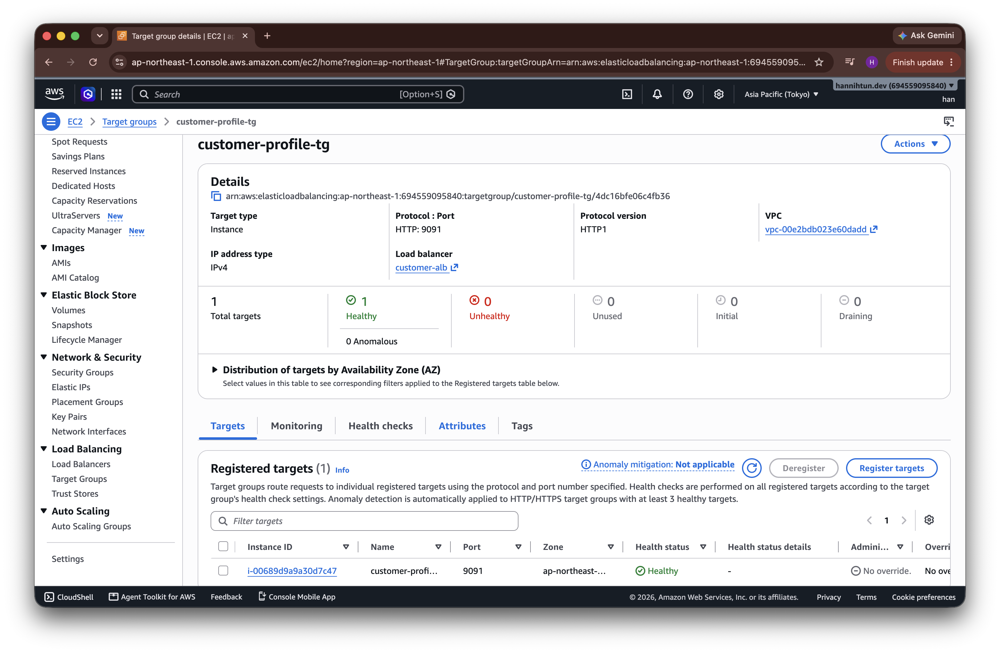 |

**Amazon Route 53**

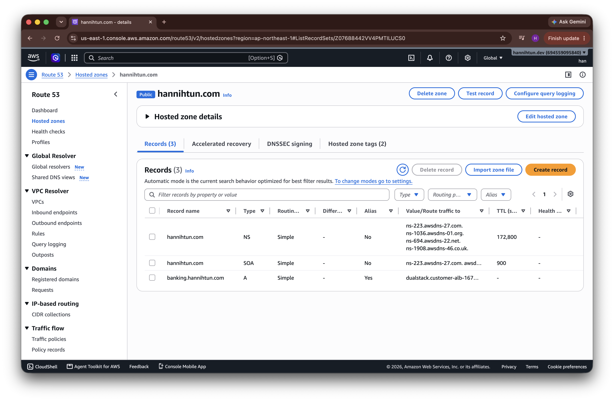

### 3. Application Results

The Fake Service web interface shows the request flow between Customer Profile, Account, and Statement across the three VPCs.

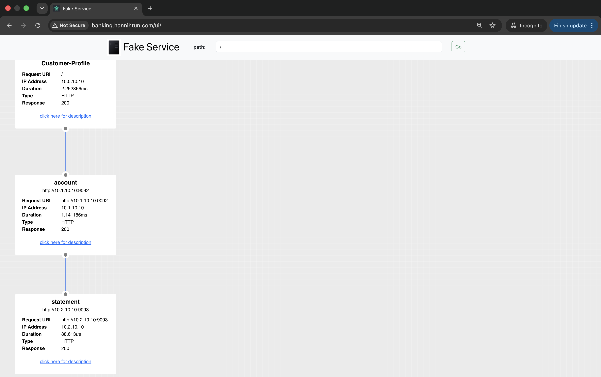

## Verification Results

| Test | Result |
|---|---|
| VPC Peering connectivity | Customer → Account → Statement successful |
| Application health checks | HTTP 200 for all three services |
| ALB target health | 1 Healthy, 0 Unhealthy |
| Route 53 DNS resolution | Successful |
| Public HTTP access | HTTP 200 OK |
| End-to-end microservices communication | All three services returned HTTP 200 |
| Fake Service Web UI | All three services displayed successfully |

---

## Limitations and Future Improvements

- **HTTPS:** The current ALB uses HTTP. HTTPS can be implemented using AWS Certificate Manager and an HTTPS listener.
- **High availability:** Each application runs on a single EC2 instance. Auto Scaling and Multi-AZ application deployments would improve availability.
- **Automation:** Infrastructure was configured manually using the AWS Console. Terraform and CI/CD could automate deployment and management.

---

## Application Source

This project uses [Fake Service by Nicholas Jackson](https://github.com/nicholasjackson/fake-service), version `v0.26.2`, to simulate communication between microservices.
